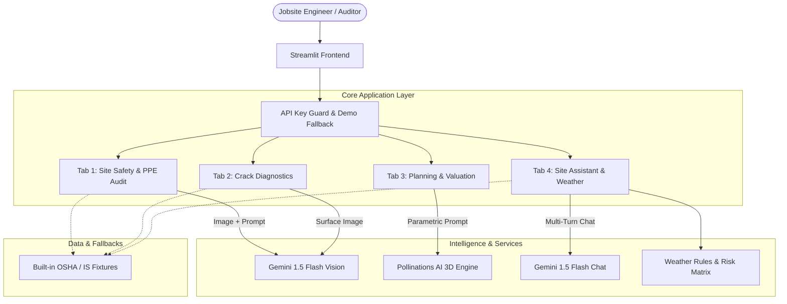

# 🏗️ Multimodal Construction Intelligence Platform
### Skill Wallet Capstone Project 1 · AI-Powered Engineering & Site Analytics

[](https://streamlit.io)
[](https://www.python.org/)
[](https://aistudio.google.com/)
[](LICENSE)

An enterprise-ready, full-stack AI platform designed for structural engineers, construction managers, HSE safety auditors, and real estate developers. Built with **Streamlit** and powered by **Google Gemini 1.5 Flash Vision & Language**, the platform delivers real-time multimodal intelligence across active jobsites and structural assets.

---

## 🌟 Core Features & Modules

### 1. 🔑 Smart Sidebar & Authentication
- **Secure API Key Input**: Enter your Google Gemini API key via a masked input with session-based memory and zero disk logging.
- **Graceful Demonstration Fallback**: If no API key is provided, the platform automatically switches to **Interactive Demo Mode**, populating pre-audited OSHA/IS datasets and interactive diagnostics.
- **System Architecture & Feature Navigation**: Visual breakdown of models, tech stack, and rapid module jumpers.

### 2. 🦺 Tab 1 — Site Safety & PPE Audit (Epic 2)
- **Multimodal Site Photo Analysis**: Upload JPG, PNG, or WebP construction photographs.
- **OSHA & IS Standards Engine**: Evaluates adherence against **OSHA 29 CFR Part 1926** and **IS 456:2000 / NBC 2016**.
- **Comprehensive PPE Checklist**: Detects hard hats, high-vis vests, steel-toe boots, safety harnesses, protective goggles, and gloves with worker headcounts and compliance flags.
- **Hazard Register**: Automatic classification of site hazards with severity tags (`Low`, `Medium`, `High`, `Critical`) and actionable engineering remedies.
- **KPI Metrics & Report Export**: Real-time safety index (0–100), compliance metric cards, status pills, and **1-click downloadable JSON audit report**.

### 3. 🔬 Tab 2 — Crack Diagnostics & Structural Integrity (Epic 2)
- **Concrete & Masonry Defect Classification**: Identifies defect classes:
  - `Hairline Shrinkage Crack` (HC-01)
  - `Settlement Crack` (SC-02)
  - `Structural Shear Crack` (SC-03)
  - `Thermal Expansion Crack` (TC-04)
  - `Spalling & Delamination` (SP-05)
- **Dimensional & Risk Assessment**: Estimates crack width (mm), crack length (mm), orientation, section depth, and load-bearing impact.
- **Engineering Repair Specifications**: Provides detailed remediation methods (structural epoxy injection, CFRP composite wrapping, micro-fine re-grouting, polyurethane joint seals) with cost estimates in INR.
- **Urgency Triage & Compliance**: Cites **IS 456 Clause 6.2**, **IS 13920**, **ACI 224.1R**, and **ASTM C881** with urgency progress bars.

### 4. 🏙️ Tab 3 — Planning & Real Estate Valuation (Epic 3)
- **Parametric Project Modeling**: Interactive inputs for:
  - Structure type (Residential Villas, Apartments, Commercial IT Parks, Industrial Warehouses, Hospitals)
  - Built-up area (sq ft) and floor count
  - Indian city location tiers (Tier 1 Metros, Tier 2 Capitals, Tier 3 Growth Centers)
  - Construction completion percentage slider (0–100%)
- **Dynamic Financial Calculations**:
  - Total project budget (civil works, contingency, GST, land acquisition)
  - Capital expenditure (CAPEX) incurred to date
  - Completed market asset valuation in INR (**Lakhs & Crores**)
  - Developer ROI & capital appreciation metrics
- **Material Take-Off (MTO)**: Automated estimation of structural steel (kg), cement bags, fine aggregate (sand), and coarse aggregate consumed vs. remaining.
- **Milestone Progress Tracker**: Visual progress across 6 construction milestones (Excavation → Structure → Infill → MEP → Finishing → Handover).
- **Conceptual 3D Architectural Rendering**: Integrated AI rendering pipeline using Pollinations AI with editable design prompts.

### 5. 🤖 Tab 4 — Daily Site Assistant & Weather-Aware Advisory (Epic 5)
- **Dynamic Weather Condition Selector**: Select between:
  - `☀️ Normal / Clear`
  - `💨 High Wind (>50 km/h)`
  - `🌧️ Heavy Rain / Monsoon`
  - `🌡️ Extreme Heat (>42°C)`
  - `⛈️ Thunderstorm / Lightning`
- **Weather-Triggered Safety Advisories**:
  - Immediate crane & hoist suspension thresholds per OSHA 1926.1417 & IS 3938
  - Ground fault and electrical hazard mitigations (GFCI/ELCB 30mA)
  - Concrete curing protocols under extreme thermal or monsoon conditions
  - Worker heat-stress and hydration schedules per OSHA Heat Illness Prevention Standard
- **Multi-Turn Construction Engineering Chatbot**: AI assistant trained on Indian Standards (IS), OSHA, and National Building Code (NBC 2016) with quick-prompt shortcuts and conversation clearing.

---

## 🏛️ Architecture & Tech Stack



- **Frontend & App Framework**: Streamlit (v1.32+)
- **LLM & Multimodal AI**: Google Gemini 1.5 Flash (`google-generativeai`)
- **Image Processing**: Pillow (PIL)
- **3D Visualization**: Pollinations AI (Diffusion Engine)
- **Database Dependency**: **Zero external database required** (Stateless, session-driven, Community Cloud ready)

---

## 🚀 Quickstart & Local Installation

### Prerequisites
- Python 3.10, 3.11, or 3.12
- Git (optional)
- (Optional) Free Google Gemini API Key from [Google AI Studio](https://aistudio.google.com/apikey)

### 1. Clone or Download Repository
```bash
git clone https://github.com/your-username/multimodal-construction-intelligence.git
cd "multimodal-construction-intelligence"
```

### 2. Create Virtual Environment
```bash
# Windows
python -m venv venv
venv\Scripts\activate

# macOS / Linux
python3 -m venv venv
source venv/bin/activate
```

### 3. Install Dependencies
```bash
pip install -r requirements.txt
```

### 4. Launch the Streamlit App
```bash
streamlit run app.py
```
The application will launch in your browser at `http://localhost:8501`.

---

## ☁️ 1-Click Streamlit Community Cloud Deployment

1. Push this project folder to your GitHub repository.
2. Sign in to [share.streamlit.io](https://share.streamlit.io/).
3. Click **"New app"**, select your repository, branch (`main`), and set the main file path to:
   ```
   app.py
   ```
4. *(Optional)* In **Advanced Settings → Secrets**, configure your Gemini API key:
   ```toml
   GEMINI_API_KEY = "your_gemini_api_key_here"
   ```
5. Click **"Deploy!"** Your application will be live globally in under 2 minutes.

---

## 📋 Regulatory Standards Referenced

| Standard Code | Title / Jurisdiction | Module Applied |
| :--- | :--- | :--- |
| **OSHA 29 CFR 1926.502** | Fall Protection Systems Criteria and Practices (USA) | Tab 1 (PPE Audit), Tab 4 (Weather) |
| **OSHA 29 CFR 1926.1417** | Crane Operations in High Wind Conditions | Tab 4 (Weather Advisory) |
| **IS 456:2000** | Code of Practice for Plain and Reinforced Concrete (BIS India) | Tab 1, Tab 2 (Cracks), Tab 3 |
| **IS 13920:2016** | Ductile Design and Detailing of Reinforced Concrete Structures | Tab 2 (Structural Shear) |
| **IS 1786:2008** | High Strength Deformed Steel Bars for Concrete Reinforcement | Tab 3 (Material Take-off) |
| **IS 1904:1986** | Design and Construction of Foundations in Soils | Tab 2 (Settlement Cracks), Tab 4 |
| **IS 3696** | Safety Code of Scaffolds and Ladders | Tab 1, Tab 4 |
| **ACI 224.1R-07** | Causes, Evaluation, and Repair of Cracks in Concrete (American Concrete Inst.) | Tab 2 (Crack Diagnostics) |
| **ASTM C881** | Standard Specification for Epoxy-Resin-Base Bonding Systems | Tab 2 (Structural Repairs) |
| **NBC 2016** | National Building Code of India | Tab 1, Tab 3, Tab 4 |

---

## 📁 Project Structure

```
Multimodal Construction Intelligence Platform/
├── .streamlit/
│   └── config.toml           # Streamlit theme and server configuration
├── app.py                    # Main application entry point & sidebar
├── styles.py                 # Modern CSS styles & dark UI design tokens
├── gemini_utils.py           # Gemini 1.5 Flash Vision & Chat wrappers
├── demo_data.py              # Zero-key fallback datasets & OSHA/IS fixtures
├── tab_safety.py             # Tab 1: PPE compliance audit module
├── tab_crack.py              # Tab 2: Structural crack diagnostics module
├── tab_valuation.py          # Tab 3: Planning, financial valuation & MTO
├── tab_assistant.py          # Tab 4: Weather advisory & engineering chat
└── requirements.txt          # Production package dependencies
```

---

## 👨‍💻 Skill Wallet Capstone Attribution
- **Project**: Capstone Project 1 — Multimodal Construction Intelligence Platform
- **Lead Developer**: Full-Stack AI Engineer
- **Environment**: Python 3.12 · Streamlit Community Cloud Ready

